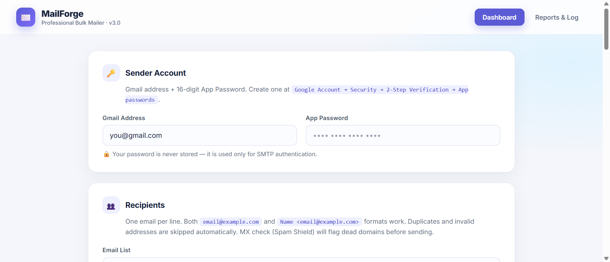
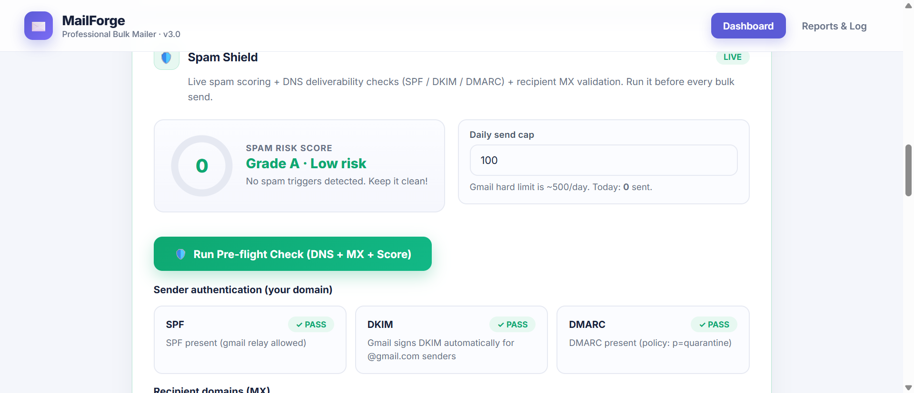

# 🛡️ MailForge

**Professional bulk mailer with a built-in Spam Shield** — a clean local web app that sends personalized emails through Gmail SMTP, and actively works to keep them out of the spam folder.



## ✨ Features

### 📧 Bulk sending
- Paste a recipient list (one per line, `Name <email>` supported)
- **Personalization** — `{{name}}` and `{{email}}` placeholders make every mail unique
- Unique `Message-ID` per mail, `Reply-To` set, plain-text or HTML (multipart) format
- Configurable delay between mails (1s–4s), rate-limited delivery
- Duplicate and invalid addresses are skipped automatically

### 🛡️ Spam Shield (why mails don't land in spam)
- **Live spam score (0–10, Grade A–F)** — updates as you type, with per-issue points
- **50+ spam-trigger word dictionary** (free, winner, act now, guarantee, casino …)
- **Pre-flight Check** — one click verifies your real DNS records:
  - ✅ **SPF** — is Gmail allowed to send for your domain?
  - ✅ **DKIM** — is the public key published? (`google._domainkey`)
  - ✅ **DMARC** — policy present?
  - ✅ **Recipient MX** — flags dead domains that would only bounce
  - ❌ Each failure comes with the exact TXT record to fix it
- **Send gates** (enforced server-side):
  - Blocks sends with spam score > 6 (can be disabled)
  - Daily send cap (default 100, Gmail hard limit ~500/day)
  - Skips recipients on domains with no MX records
  - Warm-up batch limit (20/50) for new accounts
- **List-Unsubscribe header** (RFC 8058) + unsubscribe footer
- `Precedence: bulk`, proper `X-Mailer`, TLS 1.2+



## 🚀 Quick start

```bash
git clone https://github.com/amitkushwaha1/mailforge.git
cd mailforge
npm install
npm start
```

Open **http://localhost:3456** and you're in.

### 🌐 Run it "live" from your own PC (free, no hosting needed)

```powershell
powershell -ExecutionPolicy Bypass -File start-live.ps1
```

Starts the server **with the password gate** plus a free Cloudflare quick
tunnel, giving you a public `https://….trycloudflare.com` URL (saved to
`live-url.txt`) — open it from your phone or any browser. A shortcut in the
Windows Startup folder brings everything back automatically at sign-in.

> **Note:** the tunnel sends through *your* machine, so Gmail SMTP works
> normally (many free hosts block outbound SMTP ports 25/465/587). Your PC
> must be on; the URL changes on each restart (check `live-url.txt`).


### Getting a Gmail App Password

1. Enable **2-Step Verification** on your Google Account
2. Go to **Google Account → Security → App passwords**
3. Create one, copy the 16-digit code
4. Paste it into MailForge (your normal password is never used or stored)

## 📖 How to use

1. **Sender Account** — enter Gmail + App Password
2. **Recipients** — paste your list
3. **Message** — subject + body, use `{{name}}` for personalization
4. **🛡️ Run Pre-flight Check** — make sure SPF/DKIM/DMARC pass and no dead domains
5. **🚀 Send Mails** — watch the live progress and delivery report

> **Tip:** On a new account, start with the *4 s delay + 20-mail warm-up* option, send a test to yourself first, then run the full list.

## 📊 Reports

The **Reports & Log** page shows delivered / failed counts, success rate, and a full per-recipient log with status badges.

## ⚙️ Options

| Option | Default | Purpose |
|---|---|---|
| Delay between mails | 1.5 s | Throttling — safer for reputation |
| Mail format | Plain text | Plain text is the safest; HTML sends multipart |
| Warm-up batch limit | Off | Cap first sends on new accounts |
| Daily send cap | 100 | Never exceed Gmail's ~500/day |
| Block high spam score | On | Refuse to send risky content (score > 6) |
| Skip dead domains | On | MX check removes bouncing addresses |

## 🏗️ Tech

- **Node.js** + **nodemailer** (SMTP over TLS 1.2+)
- Zero frontend framework — one dependency, single file server
- Runs **100% on your machine** — credentials never leave your computer

## ⚠️ Responsible use

- Only email people who asked to hear from you
- Always keep the unsubscribe footer on
- Respect the daily cap and your recipients' inboxes
- Gmail's ~500 mails/day is a hard limit — for real bulk marketing use a dedicated service (SendGrid, Mailgun, …)

## 📄 License

MIT

---

Made with ✉️ by **Amit Kushwaha**
